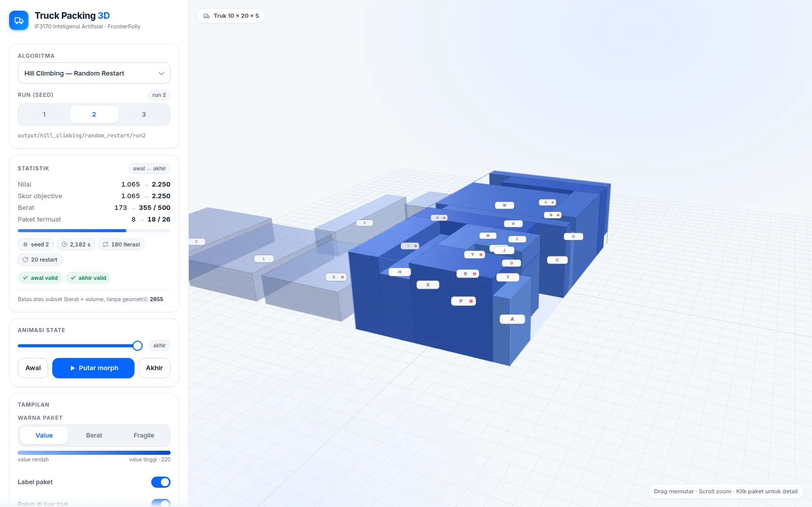

# IF3170_G32_FrontierFolly — Tugas Besar 1: Searching

Repositori Tugas Besar 1 **IF3170 Inteligensi Artifisial 2026/2027**, kelompok **G32 FrontierFolly**.

Program menyelesaikan permasalahan *3D packing* pada peti kemas truk: menyusun paket ke dalam truk berukuran 10 × 20 × 5 agar total value paket yang termuat maksimum, dengan kendala batas peti kemas, tabrakan antar paket, kapasitas berat (500), larangan paket melayang (wajib ditopang), dan larangan penumpukan barang pecah-belah (*fragile*). Solusi dicari dengan algoritma local search: empat varian Hill Climbing, Simulated Annealing, dan Genetic Algorithm, plus objective alternatif *urgency* sebagai bonus.

## Struktur Repositori

```
.
├── docs/        # laporan (PDF) + sumber DOCX
├── output/      # hasil run algoritma (state JSON, plot PNG, ringkasan JSON)
├── src/
│   ├── constraint.py         # validasi constraint state
│   ├── initial_state.py      # generator initial state acak
│   ├── visual.py             # visualisasi state 3D dan kurva nilai objective
│   ├── data/                 # data paket & truk
│   ├── hill_climbing/        # 4 varian hill climbing + eksperimen
│   ├── simulated_annealing/  # simulated annealing + eksperimen
│   └── genetic-algorithm/    # genetic algorithm
└── visualizer/  # viewer 3D web (three.js) untuk menjelajahi hasil eksperimen
```

## Setup

Dibutuhkan Python 3.10+ dan matplotlib:

```bash
python -m pip install -r requirements.txt
```

Untuk menjalankan notebook eksperimen, tambahan Jupyter:

```bash
python -m pip install jupyter
```

## Cara Menjalankan

Perintah dijalankan dari masing-masing folder di dalam `src/` karena program membaca data dari folder `../data`.

| Bagian | Perintah |
|---|---|
| Hill Climbing (4 varian × 3 run) | `cd src/hill_climbing && python hill_climbing.py` |
| Notebook eksperimen HC (+ bonus urgency) | `cd src/hill_climbing && jupyter notebook main.ipynb` |
| Simulated Annealing | `cd src/simulated_annealing && python sa.py` |
| Genetic Algorithm | `cd src/genetic-algorithm && jupyter notebook main.ipynb` |
| Trace langkah demi langkah HC | `python src/trace/trace_hc.py` (dari root repo) |
| Trace langkah demi langkah SA | `python src/trace/trace_sa.py` (dari root repo) |

Skrip trace menulis `trace.json` ke folder run di `output/` (tanpa mengubah state/plot yang sudah ada). Trace HC merekam setiap langkah; trace SA mencontohkan langkah penerimaan (maks. ±600 frame) dengan nilai akhir yang tetap identik dengan `result.json`.

Hasil run ditulis ke `output/` (state `.json`, gambar `.png`, dan ringkasan `.json` per varian/run). Validasi constraint untuk state hasil run ditampilkan sebagai badge awal/akhir di visualizer 3D.

## Visualizer 3D (Web)

Viewer three.js tanpa build step untuk menjelajahi state awal/akhir setiap run (empat varian Hill Climbing, Simulated Annealing, lima konfigurasi Genetic Algorithm, dan bonus urgency): animasi morph, statistik, validasi constraint (port dari `src/constraint.py`), dan detail paket. three.js dan font sudah di-vendor sehingga tidak butuh koneksi internet.

### Menjalankan

```bash
# dari root repo (bukan dari dalam folder visualizer/)
python3 -m http.server 8123
```

Buka <http://localhost:8123/visualizer/>. Server harus dijalankan dari root repo karena viewer membaca state dari `../output/`.

### Cara pakai

1. **Pilih algoritma dan run** di panel kiri. Run 1–3 memakai seed yang sama dengan eksperimen.
2. **Baca statistik** awal → akhir: nilai, skor objective, berat (bar terhadap kapasitas 500), jumlah paket, chip durasi/iterasi/stop reason, dan badge validitas constraint.
3. **Animasi state**: dua mode di kartu *Animasi state*.
   - **Morph**: geser slider, klik **Awal** / **Akhir**, atau **Putar morph** untuk transisi halus state awal → akhir.
   - **Trace** (tersedia untuk Hill Climbing dan Simulated Annealing): geser slider atau **Putar trace** untuk mengikuti perjalanan pencarian langkah demi langkah — setiap frame menampilkan state 3D, nilai saat itu, dan penanda kejadian (perbaikan, *sideways move*, *restart* ke-N dengan nilai barunya, atau penerimaan solusi lebih buruk beserta suhu SA). Tombol yang sama berubah menjadi **Stop** saat animasi berjalan.
4. **Warna paket**: pilih `Value`, `Berat`, atau `Fragile`. Di mode apa pun, label paket fragile diberi tanda merah `!`.
5. **Detail paket**: hover untuk tooltip, klik paket untuk pin kartu detail di kiri bawah. Tutup dengan `Esc`, tombol ×, atau klik area kosong.
6. **Kamera**: drag untuk memutar, scroll untuk zoom, klik kanan + drag untuk pan. **Reset kamera** mengembalikan view awal.
7. **Label & paket di luar truk**: atur lewat toggle di kartu Tampilan. Paket yang tidak pernah termuat ditampilkan sebagai kolom pucat di samping truk.
8. **Drag & drop** satu berkas `*State.json` ke area 3D untuk melihat state tunggal.

### URL yang bisa dibagikan

| Parameter | Nilai | Contoh |
|---|---|---|
| `algo` | `random_restart`, `steepest_ascent`, `stochastic`, `sideways_move`, `sa`, `ga_pop10_iter50`, `ga_pop30_iter25`, `ga_pop30_iter50`, `ga_pop30_iter100`, `ga_pop50_iter50`, `bonus` | `?algo=sa` |
| `run` | `1`, `2`, `3` (untuk Genetic Algorithm dipetakan ke folder `run0`–`run2`) | `?algo=sa&run=2` |
| `t` | `0`–`1` (posisi morph) | `?t=0.5` |
| `color` | `value`, `weight`, `fragile` | `?color=fragile` |
| `select` | ID paket, mis. `A` | `?select=A` |

Contoh: <http://localhost:8123/visualizer/?algo=random_restart&run=3&color=fragile>.

Tampilan default: `random_restart` run 2 (nilai 2250).



## Hasil Eksperimen (3 run)

| Algoritma | Nilai akhir terbaik |
|---|---|
| Steepest ascent | 2140 |
| Stochastic | 1710 |
| Sideways move | 2140 |
| Random restart | 2250 |
| Simulated annealing | 2040 |
| Genetic algorithm (terbaik: populasi 50, 50 generasi) | 2045 |

Ringkasan HC ada di `output/hill_climbing/summary.json`, SA di `output/simulated_annealing/run*/result.json`, GA di `output/genetic_algorithm/<pop>_<iter>/run*/finalState.json`. Analisis lengkap ada di laporan.

## Pembagian Tugas

| Anggota | NIM | Kontribusi |
|---|---|---|
| Mohammad Najmutstsaqib | 13223040 | Inisialisasi pemodelan 3D packing dan generator initial state, validasi constraint dasar, serta pengembangan Genetic Algorithm beserta eksperimennya. |
| Ega Luthfi Rais | 13524115 | Implementasi empat varian Hill Climbing dan heuristik penempatan paket, eksekusi dan visualisasi eksperimen Hill Climbing (tiga run per varian), bonus objective alternatif (urgency), penyusunan bab Pembahasan dan analisis laporan. |
| Ahmad Fauzan Putra | 13524141 | Implementasi Simulated Annealing, fungsi visualisasi umum (state 3D dan kurva nilai), README dan struktur awal repositori, dukungan eksperimen Simulated Annealing. |

## Laporan

Laporan lengkap tersedia di [`docs/`](docs/) (PDF + sumber DOCX).
